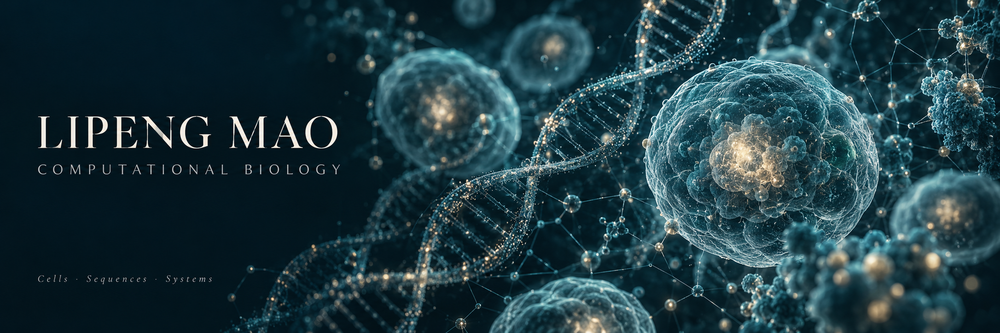

  

  <strong>从细胞、序列和代码中，理解生命的变化。</strong> 
  单细胞分析 &nbsp; / &nbsp; 免疫受体组库 &nbsp; / &nbsp; 可复现科研

  <a href="https://scholar.google.com/citations?user=0kLA6Z0AAAAJ&amp;hl=zh-CN">Google Scholar</a>
  &nbsp; · &nbsp;
  <a href="#精选项目">精选项目</a>
  &nbsp; · &nbsp;
  <a href="https://github.com/thekingofall?tab=repositories">全部仓库</a>
  &nbsp; · &nbsp;
  <a href="README.md">English</a>

 

## 关于我

<table>
<tr>
<td width="72%" valign="top">

### 你好，我是 Lipeng。

我关注**计算生物学、免疫学与科研软件**的交叉问题，尤其希望理解细胞状态和免疫受体组库如何随着发育、衰老与疾病发生变化。

这里汇集了我的测序分析代码、绘图资料和实用工具。我希望研究过程能够被清楚地理解，也能在之后重新运行、继续改进。

我喜欢把一个生物学问题拆解成清楚的分析，再把分析中有用的代码整理成别人也能使用的工具。

</td>
<td width="28%" align="center" valign="middle">

</td>
</tr>
</table>

## 关注方向

| **01 · 细胞与状态** | **02 · 免疫与时间** | **03 · 代码与发现** |
| :--- | :--- | :--- |
| 单细胞转录组、细胞图谱与细胞异质性。 | T 细胞生物学、免疫受体组库及生命周期中的变化。 | 序列处理、可复现分析流程与 AI 辅助科研。 |

## 精选项目

<table>
<tr>
<td width="50%" valign="top">

### [Biosoft · Bioseq](https://github.com/thekingofall/Biosoft-Bioseq)

按 barcode 拆分 BAM、统计 FASTQ 目标序列，以及提取基因和启动子序列的工具集。

**序列分析** &nbsp; · &nbsp; Python / Shell

</td>
<td width="50%" valign="top">

### [Biosoft · MiXCR Python](https://github.com/thekingofall/Biosoft-Project-MiXCR-Python)

面向研究的人类 V(D)J 分析 Python 实现，附中英文使用说明和可复现测试。

**免疫受体组库** &nbsp; · &nbsp; Python

</td>
</tr>
<tr>
<td width="50%" valign="top">

### [人类胎儿血液免疫图谱](https://github.com/thekingofall/scFetallife_Blood)

研究人类血液免疫系统发育的分析代码与绘图数据。

**单细胞生物学** &nbsp; · &nbsp; 分析与可视化

</td>
<td width="50%" valign="top">

### [Biosoft · Download](https://github.com/thekingofall/Biosoft-Download-upanddown)

整合 ENA/Aspera、诺禾云和 Synapse 的科研数据下载工具。

**科研流程** &nbsp; · &nbsp; 数据获取

</td>
</tr>
</table>

## 日常工具

用 **R 与 Python** 做分析和绘图，用 **Linux 与 Shell** 组织数据流程，用 **Git** 保留代码的变化。

我重视明确的问题、读得懂的方法，以及能把生物学发现讲清楚的图。证据、代码和解释应当彼此对应。

## 工作之外

喜欢科学插画、阅读和打磨顺手的小工具，也享受好奇心与视觉设计相遇的过程。

---

  <em>好问题，清楚的证据，有用的代码。</em>  
  <a href="https://scholar.google.com/citations?user=0kLA6Z0AAAAJ&amp;hl=zh-CN">研究与论文 ↗</a>
  &nbsp; · &nbsp;
  <a href="https://github.com/thekingofall?tab=repositories">浏览代码 ↗</a>

